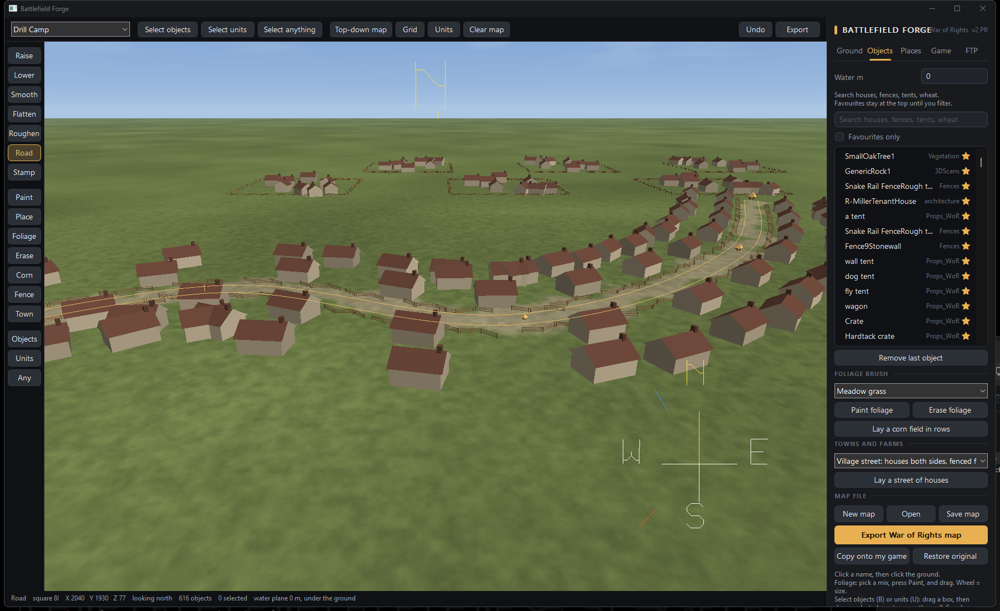
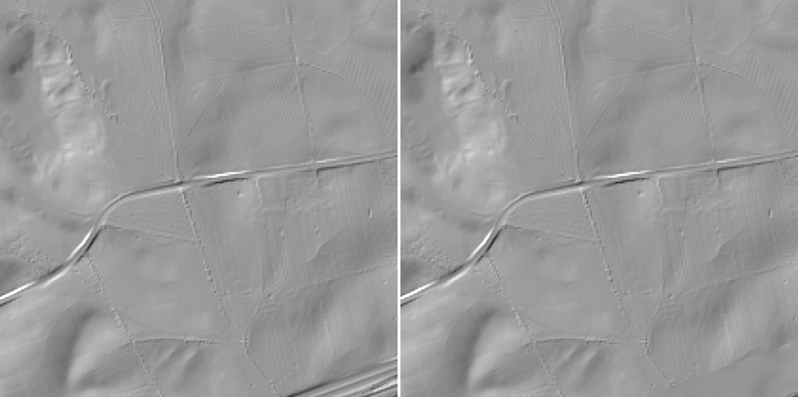
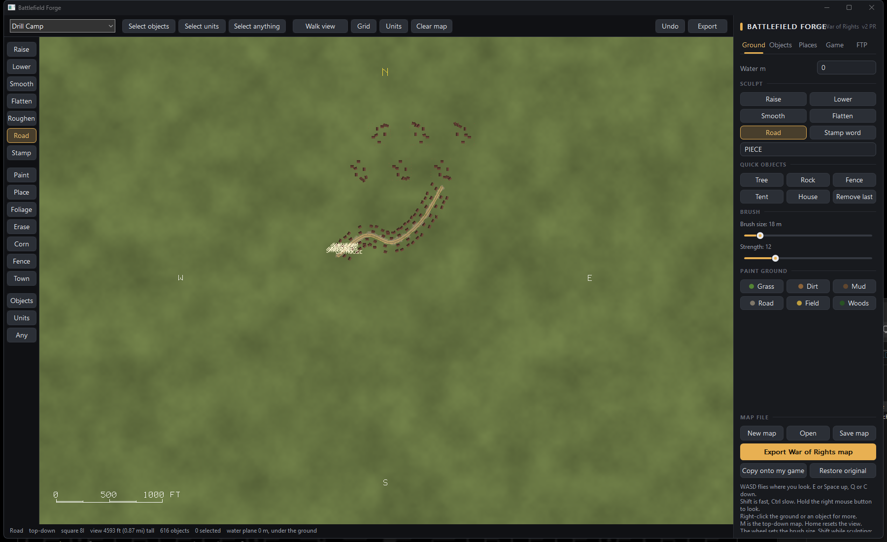
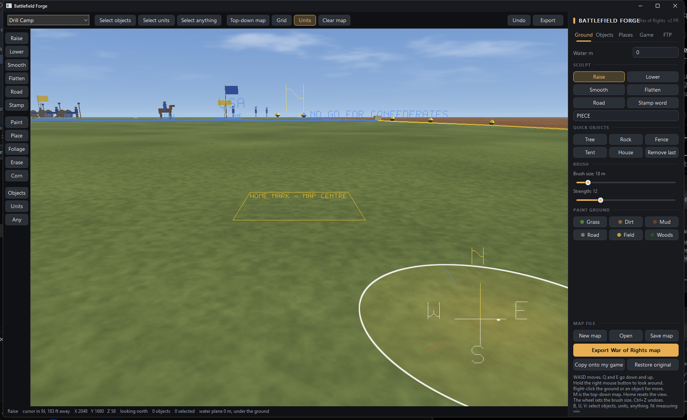

# Battlefield Forge

**A map editor for War of Rights.** Sculpt a 4 km by 4 km battlefield, pull in the real ground of a named place, lay roads, fences, farms and villages from the game's own buildings, set the spawns and play zones of any game mode, and export a level the game loads. A small companion program puts the map into any player's game in one click and takes it out again.

[**Download BattlefieldForge.zip**](https://github.com/imchris1/-WOR-Piece-Editor-v2PR/releases/download/v2PR/BattlefieldForge.zip) (115 MB) · [Release page](../../releases/tag/v2PR) · [Small edition](https://github.com/imchris1/-WOR-Piece-Editor-v2PR/raw/main/BattlefieldForge%20%28small%29.exe) (1.6 MB)

Until 11 November 2026 this was the WOR Piece Editor. Same program, new name. Maps made with either open in the other.

**Why it exists.** I came from Arma 3, where the editor and the freedom to make a mission file and hand it round were half the game. War of Rights players had nothing like it. I do not play War of Rights myself; this is built for the people who do, and it gets better from what they report.

**Work in progress.** New builds most days. Expect rough edges, and expect things to change between builds. Say what went wrong and it gets fixed in the next build. Your saved maps keep working.

## Download

| Edition | Size | Needs the game to start? | Get it |
|---|---|---|---|
| **Standalone** (recommended) | 115 MB zip | No | [BattlefieldForge.zip](https://github.com/imchris1/-WOR-Piece-Editor-v2PR/releases/download/v2PR/BattlefieldForge.zip) on the [release page](../../releases/tag/v2PR) |
| **Small** | 1.6 MB exe | Yes, it builds its files from your installed game | [BattlefieldForge (small).exe](https://github.com/imchris1/-WOR-Piece-Editor-v2PR/raw/main/BattlefieldForge%20%28small%29.exe) |

**What you need:** Windows 10 or 11 (64 bit), a graphics card from the last ten years, and about 1 GB of free space. War of Rights through Steam, to play what you make. Nothing has to be installed.

Why a zip and not one exe

On 11 November 2026 Windows Defender's machine-learning model started calling the old one-file download a virus. That was a wrong guess: it saw a program unpacking files from inside itself, the way a virus installer does. The zip has no such step. If your antivirus still objects to the editor, it is wrong, and a report of what it said helps.

## Start in five minutes

1. Unzip the folder anywhere you can write to, such as your Desktop or Documents. Keep the files together.
2. Run `BattlefieldForge.exe`. Windows warns about an unknown publisher: click **More info**, then **Run anyway**.
3. The first start takes under a minute while the editor builds its level file beside itself. That happens once.
4. You are looking at the map. `WASD` flies, hold the right mouse button to look, `M` is the top-down map. Pick a tool from the panel down the left edge, drag on the ground, and press **Export War of Rights map** when you want to try it.

Small edition: put the exe anywhere and run it. If it cannot find the game by itself it asks for the game folder, usually `<a drive>:\SteamLibrary\steamapps\common\War of Rights`. In Steam: right-click War of Rights, Manage, Browse local files.

## What you can do

**Ground**
- Raise, lower, smooth, flatten and roughen with a brush from 1 m to hundreds of metres. `Shift` while sculpting is a heavy hand.
- **Load real terrain** for a place by name on the Places tab. It uses public US elevation data and smooths modern highways back out of the ground, so a battlefield does not have an interstate in it.
- Paint grass, dirt, mud, road, field and woods with soft edges between them, and set a water level.

**Roads, fences, farms and villages**
- **Roads are real roads.** Click node after node and the road curves through them, graded flat across and even along. Drag a node to bend it, right-click for width and surface (dirt road, forest track, double track). On export every road is the game's own road mesh, with its texture.
- **Fences** are laid end to end along a drag; start the next run where the last ended to turn a corner.
- **Towns and farms.** Pick a mix (village street, farm lane, hamlet, one farmstead) and drag along a street: houses stand on both sides with fenced fronts and outbuildings behind, farm lanes get whole farmsteads with barns and yards. Right-click a road and **Line this road with houses** does the same along its curve.

**Objects and foliage**
- Every building, fence, prop and plant the Drill Camp level knows, plus the buildings and props of Antietam, Harpers Ferry and South Mountain. Click to set one, or hold and drag to lay a row.
- Foliage brushes: meadows, woods, orchards, reeds, standing wheat, corn in rows, hedgerows, big hardwoods, rocks.
- Select, move, turn and resize with a box select and an axis handle, as in a 3D program.

**Game modes and play zones**
- Pick Drill Camp, a Skirmish area, Conquest, Contention or Picket Patrol and the editor shows that mode's spawns, staging areas, boundaries and capture points. Move and turn them, or right-click the ground and **Place a unit here**.
- Every zone is drawn as a fence with a node on each corner. Drag a node, stretch the zone, fit it round the units, or move it to where you point. Ground outside the play zone is washed red, and units left outside are flagged before export.
- Tickets and cavalry for Conquest and Contention on the Game tab.

**Finding your way**
- Fly camera, top-down map, a clear-map switch, named grid squares with a feet ruler, a scale bar, a measuring pin, and a stamp tool that writes a word into the ground.

**Export and share**
- **Export War of Rights map** writes a level the game loads. **Copy onto my game** puts it into your own game for a look; **Restore original** puts the game's file back.
- Upload straight to a server over FTP from the FTP tab.

## Getting a map into the game

The game does not send a level to a joining player, so every player installs the map once. Export makes a map file and the **Map Patcher** (`BattlefieldForgePatcher.exe`, in the same folder as the editor) is all a player needs: drop the map file on its window and press **Patch**. **Restore** puts the game's own files back. The editor never touches your game unless you press **Copy onto my game**.

A map takes the Drill Camp slot, on the server and on each player's PC, because a custom level folder cannot be started on the hosted servers available to the community. The server list shows your map's name; the mode column still says Drill Camp.

## Keys

| Key | Does |
|---|---|
| `W A S D` | fly where you look; `Shift` fast, `Ctrl` slow |
| `E` or `Space`, `Q` or `C` | up, down |
| right mouse button (hold) | look around |
| `M` | top-down map |
| `B`, `U`, `V` | select objects, select units, select anything |
| `N` | measuring pin |
| `Enter` | finish a road |
| `Delete` | remove the road node under the cursor |
| `Ctrl+Z` | undo |
| mouse wheel | brush size |

## If something goes wrong

Press `Win+R`, type `%APPDATA%\BattlefieldForge` and press Enter. Send the file `diagnostics.txt` from that folder, with what you did and what happened, by [opening an issue](../../issues) here. If the editor said your graphics driver refused a shader, send `shader_log.txt` from the same folder too. Your settings, autosaves and backups live in that folder as well.

## What's new

**12 November 2026**

- **Fixed: the editor would not start on AMD and Intel graphics cards.** It stopped with `ERROR: 0:35: 'patch' : syntax error`. One word in the ground shader was a name those drivers reserve; NVIDIA's driver had let it through, so it never showed on the build PC. Every shader is now checked against the whole GLSL keyword list before a build goes out, and if a driver ever refuses a shader again the editor says so plainly, names the card, and writes `shader_log.txt` beside `diagnostics.txt`.
- **Roads are real roads.** The Road tool lays nodes: click along the way the road goes and it curves smoothly through every node, as wide as the brush was when you started. Enter finishes it. Drag a node to bend the road, Delete removes the node under the cursor, click an end node to carry the road on. Right-click a road for its width, its surface (dirt road, forest track, double track), a node where you point, or to take it away. The ground is graded flat across the road and even along it as you go, and one Ctrl+Z takes back the node and the ground together. On export every road is written as the game's own road mesh, so in the game it is a proper dirt road with its texture, not only a strip of ground paint.
- **Towns and farms.** On the Objects tab, pick a mix (village street, farm lane, hamlet, or one farmstead) and drag along a street: houses stand along both sides with fenced fronts and outbuildings behind; a farm lane puts whole farmsteads with barns, spring houses, corn cribs, hay and a fenced yard every 120 m. A short drag puts one farmstead where you pressed. Right-click a road and **Line this road with houses** does the same along its curve. The buildings are the game's own; a building's front is not known from its model, so each stands with its long side along the street, and the ring handle turns it.
- Typing in the object search box no longer trips the single-letter hot keys.

<b>11 November 2026</b>

- **The download is now a zip, not a single exe.** Windows Defender's machine-learning model started calling the one-file build a virus on 11 November (a wrong guess: it saw a program unpacking files from inside itself). The zip has no such step. Unzip it, keep the files together, and run `BattlefieldForge.exe`. The first start builds the editor's level file beside it, once.
- **New name: Battlefield Forge.** Your settings, autosaves and backups from the WOR Piece Editor move over on the first start, and the old folder name keeps working for older copies.
- **Play zones are drawn.** Every zone of the chosen game mode shows as a fence: yellow for the play zone, red and blue for the ground each side may not enter, orange for capture areas, tent colours for staging areas. Every zone carries its name at its first corner.
- **Zones are fixed on export.** A zone used to keep its original height range, so a map with high ground put every player "out of the playable zone". Export now sits every zone under its ground.
- **Zones can be reshaped.** Each corner carries a solid node. Drag a node to move that corner, pull the white square to stretch the zone, or press `-` and `=`. Right-click a fence for **Fit this play zone round the units**, **Resize this zone**, and **Put this zone back**. Right-click the ground, Camps and spawns, **Move the play zone here** puts the zone's middle on that spot.
- **Out of bounds on the ground**: everything outside the chosen mode's play zone is washed red with faint stripes, in both views. Units outside the play zone are ringed in red with the words OUTSIDE THE PLAY ZONE. The export warning lists them, selects them and puts the camera on the first; **Show me the units outside the play zone** in the ground menu does the same any time.
- **Select anything** (key `V`): one tool that picks zone nodes, units, and objects together. Select tools pick up a unit or object from a press a few pixels away, not only on the drawn figure.
- **Clear map**: a toolbar switch for a top-down map with only the ground, the zones and the units on it.
- **Place a unit here**: right-click the ground, Camps and spawns, pick a unit by name, and it moves to that spot.
- **More plants**: standing wheat, three corn mixes, tall and withered grass, flowers, forest floor, hedgerow, big hardwoods and scattered rocks in the foliage brush. **Lay a corn field in rows** (Objects tab): drag a rectangle and it fills with corn patches on a grid, rows lined up, stalks round the edge.
- Spawn points wear their own badge: rings on the ground in the side's colour and INF, CAV or ART over the figure, and a ring with the same word on the map. Artillery spawns, bases and staging points show the gun with a crewman holding the sponge-rammer.
- A clean map now moves every Drill Camp fence, door and shutter to the map's far south-west corner instead of burying it, so nothing of the old map stands on yours.
- Artillery and cavalry no longer drop from the sky: the camps' unnamed spawn spots are sat on the new ground and move with the camp. Spawn spots are lifted to 1.2 m over the ground, and a final pass on every export makes sure no spawn spot is ever written under the map.
- Upload now always sends the second map file (ground data, water, fences), not only when the map name changed.
- The yellow square at the map's middle is labelled: it is the home mark and the map centre.
- **Tool panel** down the left edge of the view: every tool one click away, the live one lit.
- **Placing is a brush**: pick an object, click to set one, or hold the button and drag to lay a row. Brush size sets the spacing.
- **Fly camera**: WASD flies where you look, E or Space up, Q or C down, Shift fast, Ctrl slow. The pace grows with your height.
- **Finer sculpting**: the brush goes down to 1 m, strength is finer at the low end, Shift while sculpting is a heavy hand, and a Roughen tool adds small bumps and detail.
- **Fence tool**: drag from one end to the other and the panels are laid end to end; start the next run where the last ended to turn a corner.

## How it works, in short

One Windows program written in C (Win32 and OpenGL 3.3), no installer, no dependencies beyond what Windows ships with. It does not replace the engine or add content. A map made with it is the Drill Camp level with new ground heights, textures, water and roads, objects added to the level's object tree, the existing spawn points, objectives and boundaries moved to new places, and the Drill Camp scenery hidden when a clean map is wanted. Everything it writes is a file the game already reads.

It cannot add spawn points or objectives, only move the ones a level already has. Some parts are untested in a live match, among them moved Conquest points and custom regiment sets.

## To Campfire Games

I would like to give this to you, for free, with no strings attached: the program, the source code, and everything I learned about the level files along the way. Use it, change it, ship it, or tell me to stop. It is your game. If any of this is something you would rather not exist, say so and it comes down.

## Contact

[Open an issue](../../issues) on this repository, and I will answer there.
