# Battlefield Forge

**A map editor for War of Rights.** Sculpt a 4 km by 4 km battlefield, pull in the real ground of a named place, lay roads, fences, farms and villages from the game's own buildings, set the spawns and play zones of any game mode, and export a level the game loads. A small companion program puts the map into any player's game in one click and takes it out again.

[**Download BattlefieldForge.zip**](https://github.com/imchris1/-WOR-Piece-Editor-v2PR/releases/download/v2PR/BattlefieldForge.zip) (115 MB) · [Release page](../../releases/tag/v2PR) · [Small edition](https://github.com/imchris1/-WOR-Piece-Editor-v2PR/raw/main/BattlefieldForge%20%28small%29.exe) (1.6 MB)

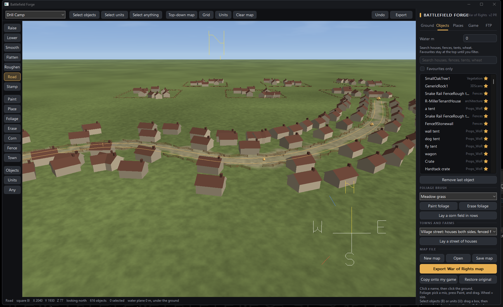

Until 11 November 2026 this was the WOR Piece Editor. Same program, new name. Maps made with either open in the other.

**Why it exists.** I came from Arma 3, where the editor and the freedom to make a mission file and hand it round were half the game. War of Rights players had nothing like it. I do not play War of Rights myself; this is built for the people who do, and it gets better from what they report.

**Work in progress.** New builds most days. Expect rough edges, and expect things to change between builds. Say what went wrong and it gets fixed in the next build. Your saved maps keep working.

**Is it safe?** Maps made here are data only: no Lua scripts, no programs. The Map Patcher refuses a map that holds any, and `BattlefieldForgePakCheck.exe` lets anyone look inside a map file and compare it with the server's copy. The full account is under [Is a map safe? Map safety and Pak Check](#is-a-map-safe-map-safety-and-pak-check).

## Download

| Edition | Size | Needs the game to start? | Get it |
|---|---|---|---|
| **Standalone** (recommended) | 115 MB zip | No | [BattlefieldForge.zip](https://github.com/imchris1/-WOR-Piece-Editor-v2PR/releases/download/v2PR/BattlefieldForge.zip) on the [release page](../../releases/tag/v2PR) |
| **Small** | 1.6 MB exe | Yes, it builds its files from your installed game | [BattlefieldForge (small).exe](https://github.com/imchris1/-WOR-Piece-Editor-v2PR/raw/main/BattlefieldForge%20%28small%29.exe) |

**What you need:** Windows 10 or 11 (64 bit), a graphics card from the last ten years, and about 1 GB of free space. War of Rights through Steam, to play what you make. Nothing has to be installed.

<details>
<summary>Why a zip and not one exe</summary>

On 11 November 2026 Windows Defender's machine-learning model started calling the old one-file download a virus. That was a wrong guess: it saw a program unpacking files from inside itself, the way a virus installer does. The zip has no such step. If your antivirus still objects to the editor, it is wrong, and a report of what it said helps.
</details>

## Start in five minutes

1. Unzip the folder anywhere you can write to, such as your Desktop or Documents. Keep the files together.
2. Run `BattlefieldForge.exe`. Windows warns about an unknown publisher: click **More info**, then **Run anyway**.
3. The first start takes under a minute while the editor builds its level file beside itself. That happens once.
4. You are looking at the map. `WASD` flies, hold the right mouse button to look, `M` is the top-down map. Pick a tool from the panel down the left edge, drag on the ground, and press **Export War of Rights map** when you want to try it.

Small edition: put the exe anywhere and run it. If it cannot find the game by itself it asks for the game folder, usually `<a drive>:\SteamLibrary\steamapps\common\War of Rights`. In Steam: right-click War of Rights, Manage, Browse local files.

## What you can do

**Ground**
- Raise, lower, smooth, flatten and roughen with a brush from 1 m to hundreds of metres. `Shift` while sculpting is a heavy hand.
- **Load real terrain** for a place by name on the Places tab. It uses public US elevation data, then takes the modern highways back out of the ground: interstates, their ramps, and the US and state routes, using the USGS road map of the same place. A battlefield does not have an interstate in it.
- Paint grass, dirt, mud, road, field and woods with soft edges between them, and set a water level.

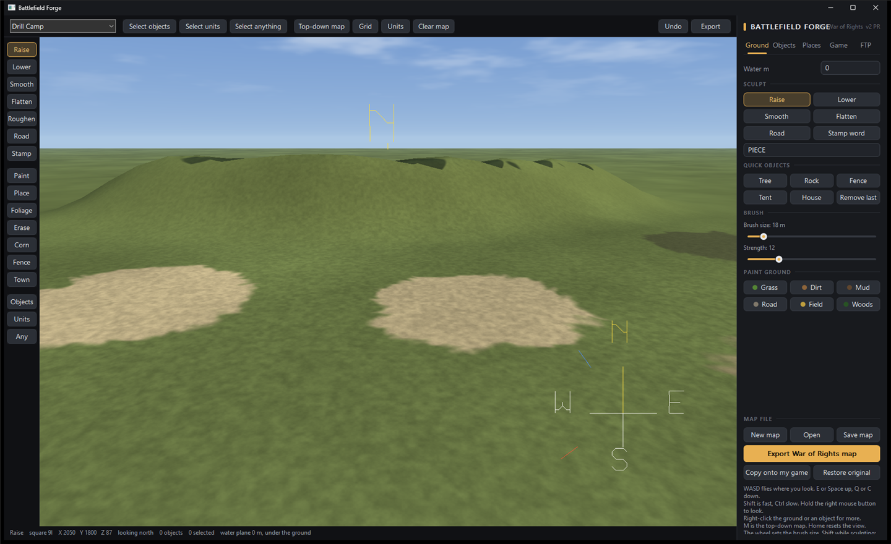

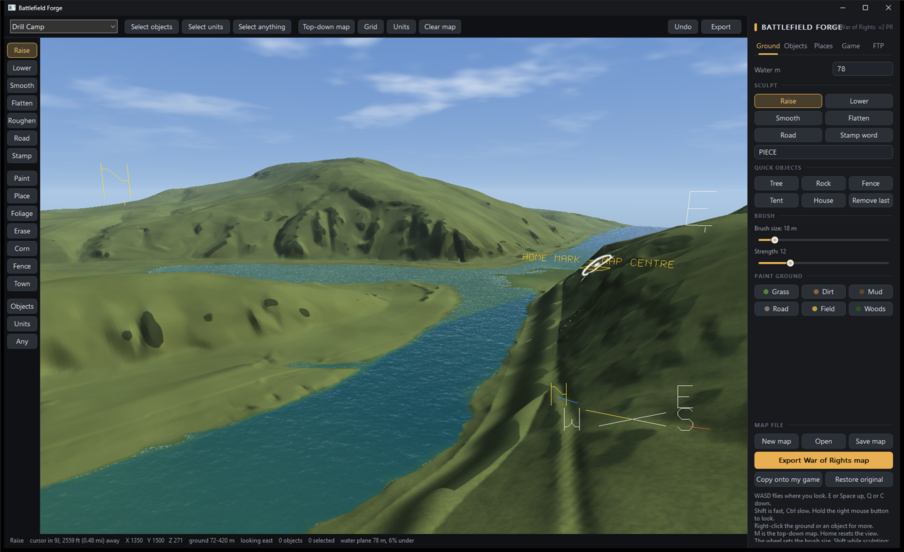

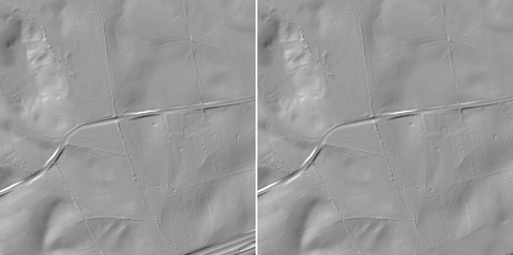

**Roads, fences, farms and villages**
- **Roads are real roads.** Click node after node and the road curves through them, graded flat across and even along. Drag a node to bend it, right-click for width and surface (dirt road, forest track, double track). On export every road is the game's own road mesh, with its texture.
- **Fences** are laid end to end along a drag the way the game's own map lays them; start the next run where the last ended to turn a corner.
- **Towns and farms.** Pick a mix (village street, farm lane, hamlet, one farmstead) and drag along a street: houses stand on both sides with fenced fronts and outbuildings behind, farm lanes get whole farmsteads with barns and yards. Right-click a road and **Line this road with houses** does the same along its curve.

**Objects and foliage**
- Every building, fence, prop and plant the Drill Camp level knows, plus the buildings and props of Antietam, Harpers Ferry and South Mountain. Click to set one, or hold and drag to lay a row.
- Foliage brushes: meadows, woods, orchards, reeds, standing wheat, corn in rows, hedgerows, big hardwoods, rocks.
- **Tree placer.** A Trees button opens a list of every tree in the game, with a picture of each, plus mixed sets for woods, oaks and orchards. Click to plant, drag for a row, or scatter them through the brush circle.
- Select, move, turn and resize with a box select and solid handles: arrows, a turning ring with a knob, a resize square and a centre disc to move freely.

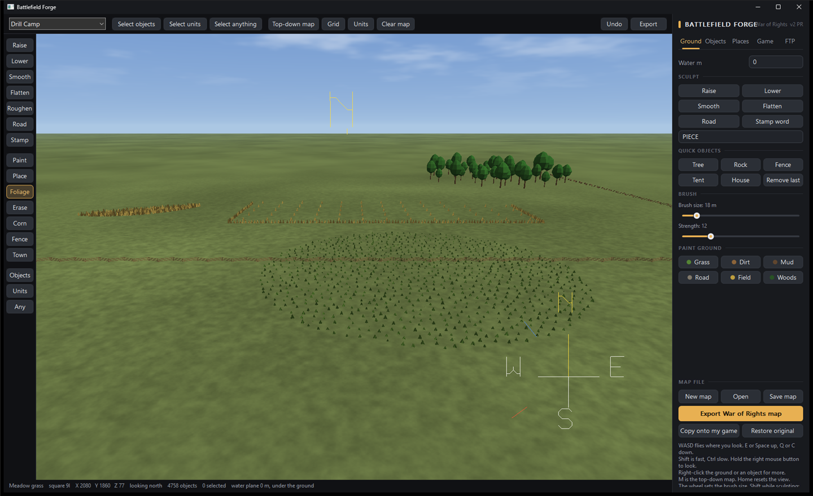

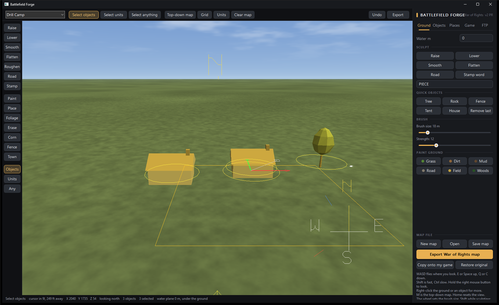

**Game modes and play zones**
- Pick Drill Camp, a Skirmish area, Conquest, Contention or Picket Patrol and the editor shows that mode's spawns, staging areas, boundaries and capture points. Move and turn them, or right-click the ground and **Place a unit here**.
- Every zone is drawn as a fence with a node on each corner. Drag a node, stretch the zone, fit it round the units, or move it to where you point. Ground outside the play zone is washed red, and units left outside are flagged before export.
- Tickets and cavalry for Conquest and Contention on the Game tab.

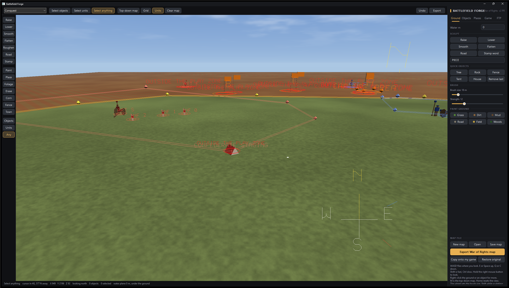

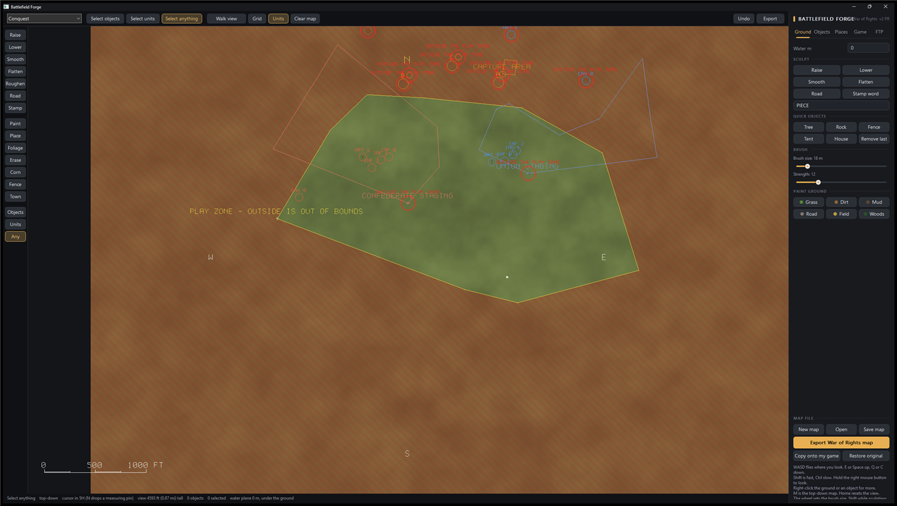

**Finding your way**
- Fly camera, top-down map, a clear-map switch, named grid squares with a feet ruler, a scale bar, a measuring pin, and a stamp tool that writes a word into the ground.

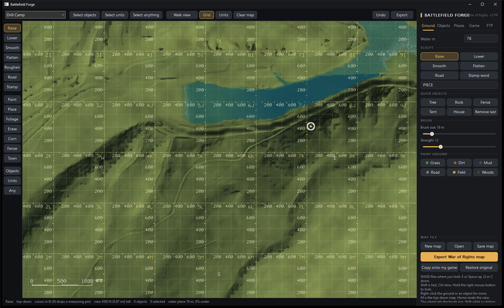

**Export and share**
- **Export War of Rights map** writes a level the game loads. **Copy onto my game** puts it into your own game for a look; **Restore original** puts the game's file back.
- A **Description** and **Date line** on the Game tab are what the game shows on the loading screen and on F2 for your map.
- Upload straight to a server over FTP from the FTP tab. Before the first upload the editor keeps the server's own map files on your PC, and **Restore original map on server** sends them back.

## Getting a map into the game

The game does not send a level to a joining player, so every player installs the map once. Two kinds of file are involved:

- A **`.worpiece`** file is your save: the map as the editor keeps it (**Save** and **Open**). Keep working on it.
- A **`.wormap`** file is the map packed for players. **Make player map files** on the Game tab writes it, with the Map Patcher and a short how-to beside it, into `export\player-files`.

The **Map Patcher** (`BattlefieldForgePatcher.exe`, in the same folder as the editor) is all a player needs: drop the map file on its window and press **Patch**. It takes a `.wormap`, and it takes a `.worpiece` save as well: the patcher carries the editor's export engine, so it builds the map from the save on the player's own PC (a few minutes; the first time it also prepares the level files from the game), writes the `.wormap` beside the save so it can be passed on, and patches it in. **Restore** puts the game's own files back. The editor never touches your game unless you press **Copy onto my game**.

A map takes the Drill Camp slot, on the server and on each player's PC, because a custom level folder cannot be started on the hosted servers available to the community. The server list shows your map's name; the mode column still says Drill Camp.

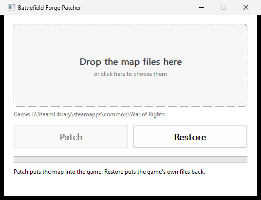

## Is a map safe? Map safety and Pak Check

**Short answer:** a Battlefield Forge map is data. It holds models, terrain and settings. It holds no Lua scripts and no programs, the Map Patcher refuses to install a map that does, and you can check any map file yourself with `BattlefieldForgePakCheck.exe`, which is in the zip and [on this page](https://github.com/imchris1/-WOR-Piece-Editor-v2PR/raw/main/BattlefieldForgePakCheck.exe).

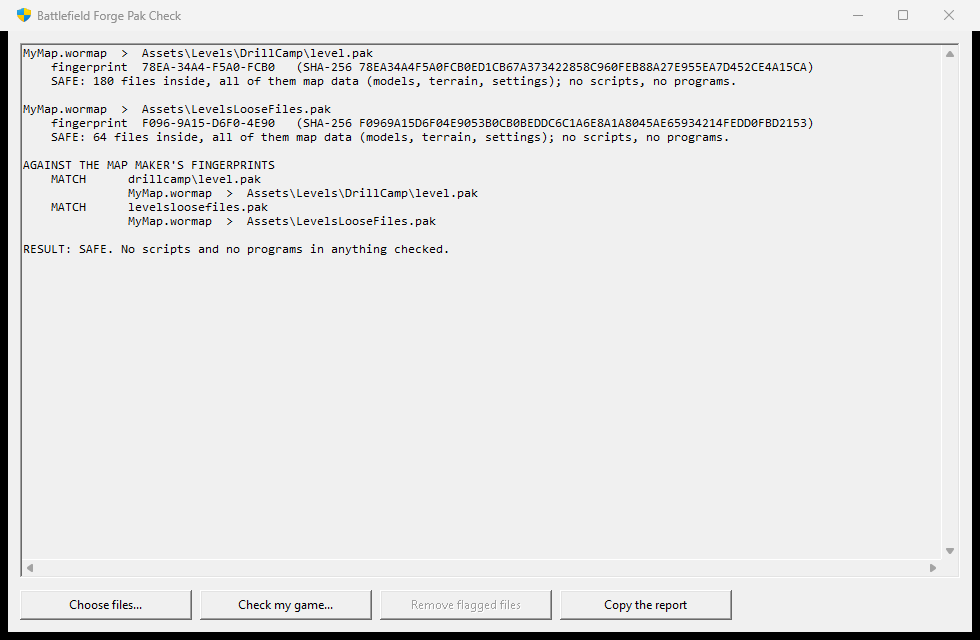

### What the worry is, and what is true

People have asked whether a custom map can carry a virus through a Lua script. Here is the plain state of things.

- **A `.pak` file is an archive.** It is a zip with another ending. You can open one with any zip program and look.
- **A map made by this editor has no scripts in it.** An export is two files, a level's `level.pak` and the level list `LevelsLooseFiles.pak`. Between them they hold only the kinds of file in the table below.
- **But an archive passed along by hand can be changed.** Someone could take a real map, add a file to the `.pak` and pass it on. The editor cannot prevent that, because it happens after the editor is closed. That is the real risk, and it is the one the Patcher and Pak Check are there for.
- **The programs are a separate matter.** The editor, the Map Patcher and Pak Check are `.exe` files. Get them from this page or the [release page](../../releases/tag/v2PR) only, never from a copy someone re-uploaded.

Whether War of Rights would run a Lua file found inside a pak has not been tested here, and nothing below depends on the answer: a map that holds one is refused either way.

### What a map may hold

| Inside a map file | Allowed? | What it is |
|---|---|---|
| `.cgf` | Yes | Models |
| `.dds` | Yes | Pictures and textures |
| `.xml`, `.json` | Yes | Level data and game mode definitions |
| `.dat`, `.bin`, `.cgb`, `.ctc`, `.bai`, `datafile_mission0_*` | Yes | Terrain, water, ground cover, placed objects, navigation |
| `.txt`, `.lst` | Yes | Lists of the level's resources |
| `.cfg` | Only plain settings | A few lines such as `Weather.Rain.Enabled=1`. Anything else in one (a command, a path, quoted text, more than 4 KB) is refused |
| `.lua`, `.luac` | **No** | Lua scripts |
| `.exe`, `.dll`, `.bat`, `.cmd`, `.ps1`, `.vbs`, `.js`, `.msi`, `.scr`, `.com`, `.jar`, `.py`, `.reg`, `.lnk` and the like | **No** | Programs and scripts Windows can run |
| `.swf`, `.gfx` | **No** | Interface files that can carry script |
| `.pak`, `.zip`, `.7z`, `.rar` | **No** | An archive inside the archive |
| A file name with hidden control characters | **No** | A name made to mislead |
| Anything else | **No** | Not a kind of file the game's own level files hold |

The "allowed" list was taken from the game itself: it is every kind of file found in the `level.pak` of Antietam, Drill Camp, Harpers Ferry and South Mountain and in `LevelsLooseFiles.pak`, plus `.dds`. Everything outside it is refused, not only the kinds named above.

### The Map Patcher checks before it installs

You do not have to do anything for this. When a map is dropped on the Map Patcher and **Patch** is pressed:

1. Every file in the map is opened and its list of contents is read, **before anything is copied**.
2. If any file holds something from the "No" rows, or is not a readable pak at all, the install stops. The message names the file and the first thing found.
3. A map may only place two kinds of file: `Assets\Levels\<level>\level.pak` and `Assets\LevelsLooseFiles.pak`. A package that wants to put a file anywhere else is refused.
4. Nothing in the game is changed when a map is refused. A package with one good file and one bad file installs neither.
5. As before, the game's own files are kept first, and **Restore** puts them back.

### Check a map yourself with Pak Check

`BattlefieldForgePakCheck.exe` is a small separate program. It installs nothing and changes nothing unless you press **Remove flagged files**.

1. Run `BattlefieldForgePakCheck.exe`. Windows may warn about an unknown program: choose **More info**, then **Run anyway**.
2. Drop on its window any of these, in any mix:
   - a `.wormap` map package
   - a `level.pak` or a `LevelsLooseFiles.pak`
   - your War of Rights folder, or press **Check my game...** and choose it (in Steam: right-click War of Rights, Manage, Browse local files)
   - a folder holding pak files
   - a `fingerprints.txt` from the map's maker (see below)
3. Read the result. Every file gets its own lines, and the last line is the verdict for everything dropped:
   - **SAFE**: nothing but map data inside.
   - **WARNING**: files a map has no use for, but no script and no program.
   - **NOT SAFE**: a script, a program, or something that cannot be part of a map. Do not use the file.
4. **Copy the report** puts the whole text on the clipboard, to send to the map's maker or a server host.

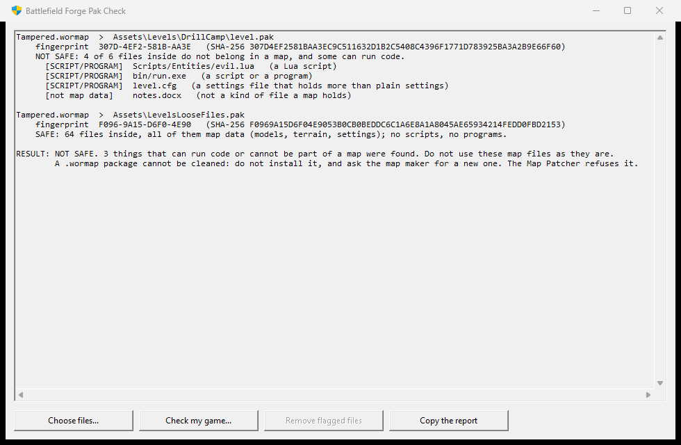

**Removing what was found.** For a `.pak` file, **Remove flagged files** writes the file again without the flagged files. Every other file in it is kept exactly as it was, and the old file stays beside it with `.unsafe-backup` added to its name. If the file is inside the game, close the game first. A `.wormap` package cannot be cleaned: do not install it, and ask the map's maker for a new one.

A file that was cleaned has a different fingerprint from the tampered one, so the server and every player then need the cleaned file. If the only thing wrong was an added file, the cleaned file is the original again, with the original's fingerprint.

Any other pak (one that is not named `level.pak` or `LevelsLooseFiles.pak`) is searched for scripts and programs only, because the game's own archives hold many more kinds of data than a map does. The report says so when that applies.

### Fingerprints: does the server have the same files as me?

A fingerprint is a short code worked out from every byte of a file (the first 16 digits of its SHA-256, which Pak Check also prints in full):

```
78EA-34A4-F5A0-FCB0  DrillCamp\level.pak
F096-9A15-D6F0-4E90  LevelsLooseFiles.pak
```

Two files with the same fingerprint are the same file, byte for byte. Change one bit and the code changes. That makes it the way to tell that the server's copy, your copy and the map maker's copy are one and the same, and that nobody changed the map on the way.

**If you make maps**

1. Export as usual. Every export writes `fingerprints.txt` into the editor's `export` folder, beside `level.pak` and `LevelsLooseFiles.pak`. **Copy onto my game**, **Upload to server** and **Make player map files** export first, so they write it too.
2. Give `fingerprints.txt` to your server's host and your players along with the map, or just paste the two lines where your community can see them.
3. After any new export the codes are new. Hand out the new file with the new map.

**If you play**

1. Install the map with the Map Patcher.
2. Run Pak Check, drop the map maker's `fingerprints.txt` on it and press **Check my game...**.
3. Under **AGAINST THE MAP MAKER'S FINGERPRINTS** each file says **MATCH** or **DIFFERENT**. MATCH on both means you have exactly the files the maker exported.

**If you host a server**

1. Fetch the two files from the server (`Assets/Levels/DrillCamp/level.pak` and `Assets/LevelsLooseFiles.pak`) into a folder on your PC, the same way you upload them.
2. Drop them on Pak Check together with `fingerprints.txt`. MATCH on both means the server runs the maker's map.
3. To compare two copies without a fingerprints file, drop both copies. Under **DO THE COPIES MATCH?** the tool says **MATCH** or **DIFFERENT** for each file it has two of.

A **DIFFERENT** most often means an older export is still on one side. Install the current map on that side again and check once more.

### What this does not do

- **The game does not check anything.** War of Rights does not compare a player's map files with the server's. Fingerprints are compared by people, with this tool.
- **It checks map files, not your PC.** Pak Check is not an antivirus. It answers one question: is there anything in this map file besides map data.
- **Installing by hand skips the Patcher.** Someone who copies a `.pak` into the game folder themselves gets no check unless they drop the file on Pak Check first.
- **The small edition does not carry it.** Pak Check is in the zip; with the small exe, download it from this page.

### For those who want to verify the tool

Nothing here asks to be taken on trust. A `.pak` opens in 7-Zip or any zip program, so the contents of any map can be read by eye. The fingerprint is a standard SHA-256, so `certutil -hashfile level.pak SHA256` in a Windows command prompt gives the same digits Pak Check prints. Pak Check also runs without a window, for scripts: `BattlefieldForgePakCheck.exe --check <files or folders> --report report.txt` ends with exit code 0 when everything is safe, 3 when something was flagged, 4 when copies that should match differ, and 1 when a file could not be read.

## Keys

| Key | Does |
|---|---|
| `W A S D` | fly where you look; `Shift` fast, `Ctrl` slow |
| `E` or `Space`, `Q` or `C` | up, down |
| right mouse button (hold) | look around |
| `M` | top-down map |
| `B`, `U`, `V` | select objects, select units, select anything |
| `N` | measuring pin |
| `Enter` | finish a road |
| `Delete` | remove the road node under the cursor |
| `Ctrl+Z` | undo |
| `Ctrl+F` | find a placed object or a unit by name and go to it |
| mouse wheel | brush size |

## If something goes wrong

Press `Win+R`, type `%APPDATA%\BattlefieldForge` and press Enter. Send the file `diagnostics.txt` from that folder, with what you did and what happened, by [opening an issue](../../issues) here. If the editor said your graphics driver refused a shader, send `shader_log.txt` from the same folder too. Your settings, autosaves and backups live in that folder as well.

## What's new

**22 November 2026**

- **Drill Camp spawns go where you put the camp.** In Drill Camp mode (the mode a custom map is played in on hosted servers) each camp has a map icon and a separate spawn point for infantry, cavalry and artillery, standing on or near the same spot. Only the spawn point decides where players appear, but the thing most people drag is the camp flag or the icon, and until now that moved the map icon alone: the game kept the old spawn places. Now an icon and its spawn point always move together, whichever you take hold of. **A map saved the old way is put right when you open it: open it, export again, and put both files on the server and in the game.**
- **Pak Check: is a map safe, and does the server have the same files as me?** A Battlefield Forge map is data only (models, terrain, settings): no Lua scripts, no programs. But a `.pak` is an archive, and one passed along by hand could have had something added. So there is now a third program, `BattlefieldForgePakCheck.exe` (in the zip, and beside this page's small exe). Drop a `level.pak`, a `LevelsLooseFiles.pak`, a `.wormap` or your War of Rights folder on it: it looks inside, lists any script, program or file a map has no use for, and says **SAFE** or **NOT SAFE**. **Remove flagged files** takes them out of a `.pak` and keeps the old file as a backup. It also prints a **fingerprint** for every file; two files with the same fingerprint are the same file, byte for byte. Every export now writes `export\fingerprints.txt`: give it to your server's host and your players, and the tool says **MATCH** or **DIFFERENT** for each of their files. The **Map Patcher** runs the same look-inside before it installs anything and refuses a map that holds a script, a program or a stray file, changing nothing in the game. (The game itself does not compare a player's files with the server's; this check is how you make sure.)
- **One battlefield for every game mode.** The level holds a separate set of spawn points for Drill Camp, for each of the 13 Skirmish areas, for Conquest and Contention and for each Picket Patrol, and the editor shows one set at a time. If you moved one set and the server plays another mode or area, players come in at the game's original Drill Camp places. **The easy way: just export.** When some modes are still on the original places the editor asks before it exports, and **Yes** puts them all on your battlefield and carries on (nothing you placed by hand is changed; Ctrl+Z undoes it). By hand: pick the game mode you set up in the list on the Objects tab, right-click the ground, **Camps and spawns**, **Use these places for every game mode**, then export again. Every other set (spawn points, capture points, zones) is turned and slid onto your battlefield, Union side towards your Union spawns. Either way put **both** exported files on the server and in the game; a map exported before 22 November needs exporting again.
- **Spawn points put players on your ground.** In Skirmish, Conquest, Contention and Picket Patrol a player does not appear on the spawn point itself but on one of 60 to 100 spots stored inside it, and each spot carried a height measured on the original Drill Camp hills. On a new ground those spots stood under it or metres over it. Every export now puts every spot of every spawn point on your ground, so **export and install your map again** (and send both files to your server) to get the fix.
- **Each mode's in-game map follows its points.** The piece of the level an area's map shows was the original Drill Camp one, so moved spawn points and capture points could fall off it; the three hidden Conquest areas always did. An area whose points were moved now gets a map square that holds them all. The picture drawn on that map is still the game's own.
- **Real model shapes everywhere in the view.** Placed objects and trees now keep their real shapes (the same ones the Objects list shows in its picture) at every distance and every zoom. Before, the simple stand-in shapes came back in the top-down map once it was zoomed out past 3 km, and in the walk view past 1.6 km. The **Real model shapes** switch on the View menu is put back on once for everyone, a model that could not be read is tried again instead of staying a stand-in for the session, and if the game is found after the editor has started the shapes now load without a restart.
- **Satellite picture on and off.** A **Show satellite picture** box on the Places tab, under **Load satellite**, takes the satellite colour off the ground and puts it back. The picture stays loaded, so it returns at once with no download, and the editor remembers the choice next time.

**21 November 2026, late**

- **Tree placer.** A **Trees** button on the left panel (or **Tree** on the Ground tab) opens a list of every tree in the game: forest trees 1 to 9 with their trunk variants, small oaks, oak bushes and apple trees, plus mixed sets (every tree, forest trees, oaks, an orchard) where each tree planted is a different one. A picture of the chosen tree shows with its real height, and a green outline of it follows the cursor. Click to plant one, hold and drag for a row a brush width apart, or tick **Scatter in circle** to plant a few at a time through the brush circle, a crown apart (Strength sets how many). **Vary size, turn** gives each tree its own facing and 85 to 120 % of its usual size.
- **Smaller brush.** The brush now goes down to 0.1 m: the low end of the slider runs 0.1 to 1.0 m in tenths, and the wheel steps a tenth at a time there. Under a metre the sculpt tools work on the nearest point of the ground, more gently the smaller the brush.
- **Handles you can see and grab.** The handles on a selection are now solid with a dark rim: thick red and green arrows, a yellow ring with a round knob to turn, a white square to resize, and a new disc in the middle to move freely. They stay the same size on screen, an arrow seen end-on no longer shrinks to nothing, the one under the cursor lights up, and the status bar says what it does. A unit standing under a handle can still be clicked and picked up.

**21 November 2026, night**

- **Fixed: the ground could fall back to the old plain look on some graphics cards.** The ground shader kept every play-zone corner in a list that many AMD and Intel drivers count as too big, and a driver that refuses the shader makes the editor draw the plain ground of older builds. The corners now travel another way, and every shader passes the Khronos reference compiler, not only NVIDIA's. If a driver ever refuses a shader again, the editor now says so on the status bar and in the View menu.
- **Trenches.** A **Trench** button under Road on the left panel: click along the line and a trench is dug through the nodes, a floor 1.5 m deep with a firing step, the earth thrown up as a parapet on the enemy side and a low bank behind, mud on the floor and dirt over the works. Drag, add and remove nodes as for roads. Right-click a trench to turn the parapet to the other side or set its width, depth and parapet height. Trenches go into the game as part of the ground.
- **Pick a place on a globe.** The Places tab's list is now a globe (NASA's Blue Marble, with sharper pictures as you come closer and aerial photos close in over the United States). Drag to turn it, wheel to come closer, click to pick, double-click to load. Battlefields are gold dots. **Save** keeps a place under your own name (blue dots, and the list under the globe); **Remove** forgets it.
- **Sharper satellite colour, and a wider picture round it.** The map's own square now comes at about 1 m a pixel (twice as sharp as before), with a 12 km picture round it.
- **Overlay adjust** (Ground tab): drag the satellite picture under the map, with the land past the map's edge showing round it, then **Load the ground under the picture** to make that the map, no coordinates to type. **Clear overlay** takes the picture off.
- **All models (beta)** on the Objects tab now leaves out a modern test vehicle, the victory banners and 66 models whose material is missing from the game's files. These pieces are not yet confirmed in the game: try a few before building a map on them.

**21 November 2026, evening**

- **Fences run the right way.** The game's own map stands snake-rail panels along the model's other axis, 4.5 m apart, all facing the same way (the zigzag is built into the model). The fence tool and the line tool now lay them like that, so a fence is one continuous zigzag along your drag instead of panels standing across it. This replaces the 15/30 degree swing from this morning.
- **Objects look like themselves.** Placed objects are drawn with their real shapes from your game's files: the actual house, tree, tent, wagon and fence, coloured by kind. View menu, **Real model shapes**, turns it off.
- **See a model before you place it.** Rest the cursor on a row of the Objects list and a picture of the model appears beside it, with the size the game places it at.
- **Raise and lower objects.** Page Up and Page Down lift the selection a quarter metre (a metre with Shift), End puts it back on the ground. In the 3D view the move handle has a blue up arrow to drag, and the right-click menu has a Height item. The height is saved with the map and exported.
- **Crops and fences follow the hillside.** Corn, wheat, grass and fences now lean with the slope, the way the game's own map has them, instead of stepping down a hill in flat layers. Trees stand on the lowest ground under the trunk, so no side of a trunk hangs in the air. View menu, **Crops, grass and fences lean with the slope**.
- **The Roulette farmhouse is full size.** The game places it at 3.17 times its built size; so does the editor now, and the same for the wagon, blankets, some tree trunks and the shale cliffs.
- **Small dips and trenches show.** The ground is drawn much finer near the camera (1 m between points), and a coarse layer no longer covers what you dig. View menu: **Plain ground** takes away the paint and picture and draws contour lines every metre, so shell holes and trenches stand out; **Detailed ground** keeps 1 m detail out to 512 m.
- **Road settings.** Right-click a road, **Road settings**: width, banks, raise it over the ground (or a negative number for a sunken lane), smooth its grade along its length, surface, and whether the surface is painted. **Use for new roads** keeps them for the next roads.
- **Scale the terrain.** View menu, **Scale the terrain**: make every hill taller or flatter, or stretch the ground wider or squeeze it in, with objects and roads moving along. The Places tab has **Area km** (how much of the real place goes on the 4 km map) and **Height x** for downloaded ground.
- **Artillery.** View menu, **Artillery spawns only** shows just the artillery spawn points of the chosen game mode; select units (U) and drag one to where the guns should come in. Objects tab, **All models (beta)** adds the game's other models to the list: cannon parts, limbers, caissons and more (search "artillery").
- **Early capture times** cannot be set by a map: the game has no such setting in a level, and capture speed is a server setting.

First build with all of these, so please say if anything misbehaves, and how it looks in the game.

**18 November 2026**

- **Satellite colour on the ground.** Load real terrain and the editor also fetches the USGS aerial picture of the same 4 km square and lays it over the ground's colour, so you can see the fields, woods, roads and rivers while you sculpt and place. The Ground tab has a Satellite colour slider, 0 to 100 %. The picture only replaces the colour: the hills keep their light, shadow and depth underneath at any setting. The Places tab has a Load satellite button for a map you opened from a file. It is for looking only and is not exported. The picture is US only, like the elevation, and needs the shader view on.
- **The picture never makes you wait.** It comes down in the background while the elevation does, and goes onto the ground when it arrives. First build with it, so please say if it misbehaves.

**15 November 2026, night**

- **Objects show their real size.** Every placed object carries its true footprint from the game's own model files: a rectangle on the ground, turned and scaled as placed, in both views, and under the cursor before you set a piece down. Select one object and the status bar gives its size in metres. The sizes are read once from your game's files and remembered.
- **Lay the chosen object in a line** (Objects tab): pick anything in the list and drag; pieces go end to end at the model's own length, long side along the line. Pontoon bridge sections, railroad pieces, stone walls. Start the next run where the last one ended to carry on.
- **Place on the water surface** (Objects tab): with this on, the placing tools stop at the water instead of the river bed, so a pontoon bridge floats where you point. Off, placing goes to the ground as before.
- **Long roads undo properly.** Ctrl+Z after grading a road that spans a lot of ground used to leave the ground as graded; now every cell the road touched goes back, with the road.

**15 November 2026, evening**

- **Your map's own words on the loading screen and F2.** The Game tab has a **Description** box and a **Date line**. They are saved with the map and go out with every export: the game shows them for whichever area of your map the server runs, in place of the Drill Camp text. Leave the box empty to keep the game's own words. First build with it, so please say if the words do not show.
- **Spawns say what they are.** Every spawn point now carries its full label in the side's colour, in both views: `USA INFANTRY 2`, `CSA ARTILLERY STAGING`, `USA CAVALRY`.
- The blue box that followed the cursor on the water plane is gone. The water grid and the depth line under the cursor stay.

**15 November 2026**

- **Restore original map on server.** A new button on the FTP tab puts the game's own map back on your dedicated server. Before the first upload with this build, the editor fetches the server's current level file and name list over the same FTP login and keeps them on your PC (under `%APPDATA%\BattlefieldForge\server-backup`); a later upload never replaces that first copy. Restore sends them back. If the server was already running one of your maps when that copy was taken, Restore sends the game's own Drill Camp level that the editor carries and your PC's untouched name list instead. Stop the server first, as for an upload.

**13 November 2026**

- **The Map Patcher takes a `.worpiece` save.** A player who dropped a save on the patcher was told it was not a map file: a save is the editor's working file, and the patcher wanted the `.wormap` that **Make player map files** writes. The patcher now carries the editor's export engine. Drop a save on it and it builds the map on that PC, writes the `.wormap` beside the save for passing on, and patches it in. Saves now also carry the Game tab's settings (water height, Drill Camp scenery, cavalry, tickets), so a map built from the save matches what its maker would have exported.
- **Ctrl+F finds anything you placed.** A search window lists every object on the map (and the units of the chosen game mode) by name and place. Type part of a name to narrow it, and the moment you pick a row the camera flies to that object and selects it, in the walk view or on the top-down map. Up and Down step through the rows from the search box, Enter goes there and closes, Esc closes. It is on the right-click menu too, as Find a placed object.

<details>
<summary><b>12 November 2026</b></summary>

- **Interstates are gone from real terrain.** The Places tab was meant to smooth modern highways out of the downloaded ground, but it asked a public OpenStreetMap server that is down more often than not, and when it got no answer the load went ahead with the highways still in. It now takes the roads from the USGS National Map, the same service the elevation comes from, and heals out interstates, their ramps, and the US and state routes. Ground you loaded before is downloaded again on the next load, so old caches get the fix too. If the road lookup ever fails, the editor now says so in a warning box instead of a status line.
- **Fixed: the editor would not start on AMD and Intel graphics cards.** It stopped with `ERROR: 0:35: 'patch' : syntax error`. One word in the ground shader was a name those drivers reserve; NVIDIA's driver had let it through, so it never showed on the build PC. Every shader is now checked against the whole GLSL keyword list before a build goes out, and if a driver ever refuses a shader again the editor says so plainly, names the card, and writes `shader_log.txt` beside `diagnostics.txt`.
- **Roads are real roads.** The Road tool lays nodes: click along the way the road goes and it curves smoothly through every node, as wide as the brush was when you started. Enter finishes it. Drag a node to bend the road, Delete removes the node under the cursor, click an end node to carry the road on. Right-click a road for its width, its surface (dirt road, forest track, double track), a node where you point, or to take it away. The ground is graded flat across the road and even along it as you go, and one Ctrl+Z takes back the node and the ground together. On export every road is written as the game's own road mesh, so in the game it is a proper dirt road with its texture, not only a strip of ground paint.
- **Towns and farms.** On the Objects tab, pick a mix (village street, farm lane, hamlet, or one farmstead) and drag along a street: houses stand along both sides with fenced fronts and outbuildings behind; a farm lane puts whole farmsteads with barns, spring houses, corn cribs, hay and a fenced yard every 120 m. A short drag puts one farmstead where you pressed. Right-click a road and **Line this road with houses** does the same along its curve. The buildings are the game's own; a building's front is not known from its model, so each stands with its long side along the street, and the ring handle turns it.
- Typing in the object search box no longer trips the single-letter hot keys.

</details>

<details>
<summary><b>11 November 2026</b></summary>

- **The download is now a zip, not a single exe.** Windows Defender's machine-learning model started calling the one-file build a virus on 11 November (a wrong guess: it saw a program unpacking files from inside itself). The zip has no such step. Unzip it, keep the files together, and run `BattlefieldForge.exe`. The first start builds the editor's level file beside it, once.
- **New name: Battlefield Forge.** Your settings, autosaves and backups from the WOR Piece Editor move over on the first start, and the old folder name keeps working for older copies.
- **Play zones are drawn.** Every zone of the chosen game mode shows as a fence: yellow for the play zone, red and blue for the ground each side may not enter, orange for capture areas, tent colours for staging areas. Every zone carries its name at its first corner.
- **Zones are fixed on export.** A zone used to keep its original height range, so a map with high ground put every player "out of the playable zone". Export now sits every zone under its ground.
- **Zones can be reshaped.** Each corner carries a solid node. Drag a node to move that corner, pull the white square to stretch the zone, or press `-` and `=`. Right-click a fence for **Fit this play zone round the units**, **Resize this zone**, and **Put this zone back**. Right-click the ground, Camps and spawns, **Move the play zone here** puts the zone's middle on that spot.
- **Out of bounds on the ground**: everything outside the chosen mode's play zone is washed red with faint stripes, in both views. Units outside the play zone are ringed in red with the words OUTSIDE THE PLAY ZONE. The export warning lists them, selects them and puts the camera on the first; **Show me the units outside the play zone** in the ground menu does the same any time.
- **Select anything** (key `V`): one tool that picks zone nodes, units, and objects together. Select tools pick up a unit or object from a press a few pixels away, not only on the drawn figure.
- **Clear map**: a toolbar switch for a top-down map with only the ground, the zones and the units on it.
- **Place a unit here**: right-click the ground, Camps and spawns, pick a unit by name, and it moves to that spot.
- **More plants**: standing wheat, three corn mixes, tall and withered grass, flowers, forest floor, hedgerow, big hardwoods and scattered rocks in the foliage brush. **Lay a corn field in rows** (Objects tab): drag a rectangle and it fills with corn patches on a grid, rows lined up, stalks round the edge.
- Spawn points wear their own badge: rings on the ground in the side's colour and INF, CAV or ART over the figure, and a ring with the same word on the map. Artillery spawns, bases and staging points show the gun with a crewman holding the sponge-rammer.
- A clean map now moves every Drill Camp fence, door and shutter to the map's far south-west corner instead of burying it, so nothing of the old map stands on yours.
- Artillery and cavalry no longer drop from the sky: the camps' unnamed spawn spots are sat on the new ground and move with the camp. Spawn spots are lifted to 1.2 m over the ground, and a final pass on every export makes sure no spawn spot is ever written under the map.
- Upload now always sends the second map file (ground data, water, fences), not only when the map name changed.
- The yellow square at the map's middle is labelled: it is the home mark and the map centre.
- **Tool panel** down the left edge of the view: every tool one click away, the live one lit.
- **Placing is a brush**: pick an object, click to set one, or hold the button and drag to lay a row. Brush size sets the spacing. **Lay the chosen object in a line** puts pieces end to end at the model's own length, and **Place on the water surface** lets a pontoon bridge float where you point.
- **Objects show their real size**: a footprint rectangle from the game's own model files, in both views and under the cursor; select one and the status bar gives its size in metres.
- **Fly camera**: WASD flies where you look, E or Space up, Q or C down, Shift fast, Ctrl slow. The pace grows with your height.
- **Finer sculpting**: the brush goes down to 1 m, strength is finer at the low end, Shift while sculpting is a heavy hand, and a Roughen tool adds small bumps and detail.
- **Fence tool**: drag from one end to the other and the panels are laid end to end; start the next run where the last ended to turn a corner.
</details>

## How it works, in short

One Windows program written in C (Win32 and OpenGL 3.3), no installer, no dependencies beyond what Windows ships with. It does not replace the engine or add content. A map made with it is the Drill Camp level with new ground heights, textures, water and roads, objects added to the level's object tree, the existing spawn points, objectives and boundaries moved to new places, and the Drill Camp scenery hidden when a clean map is wanted. Everything it writes is a file the game already reads.

It cannot add spawn points or objectives, only move the ones a level already has. Some parts are untested in a live match, among them moved Conquest points and custom regiment sets.

## To Campfire Games

I would like to give this to you, for free, with no strings attached: the program, the source code, and everything I learned about the level files along the way. Use it, change it, ship it, or tell me to stop. It is your game. If any of this is something you would rather not exist, say so and it comes down.

## Contact

[Open an issue](../../issues) on this repository, and I will answer there.
